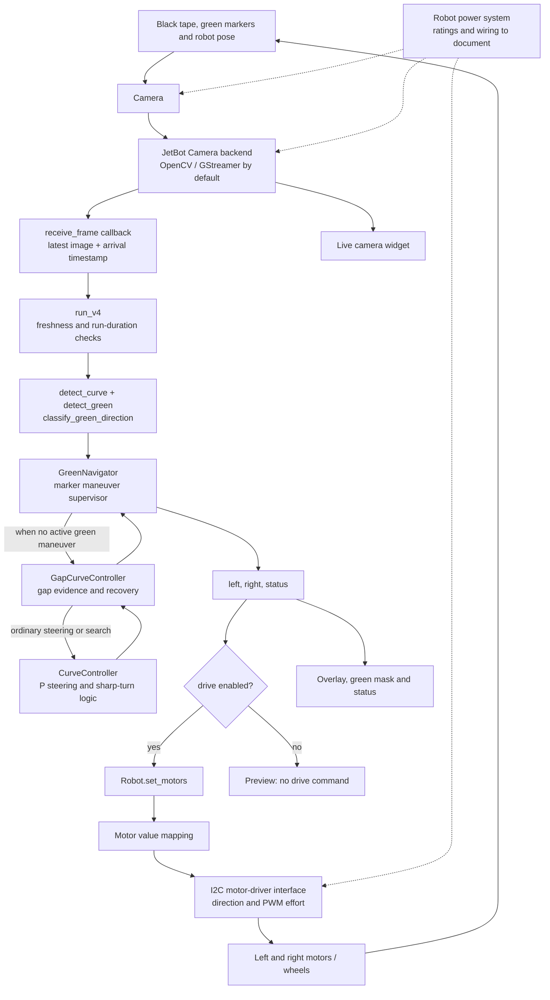
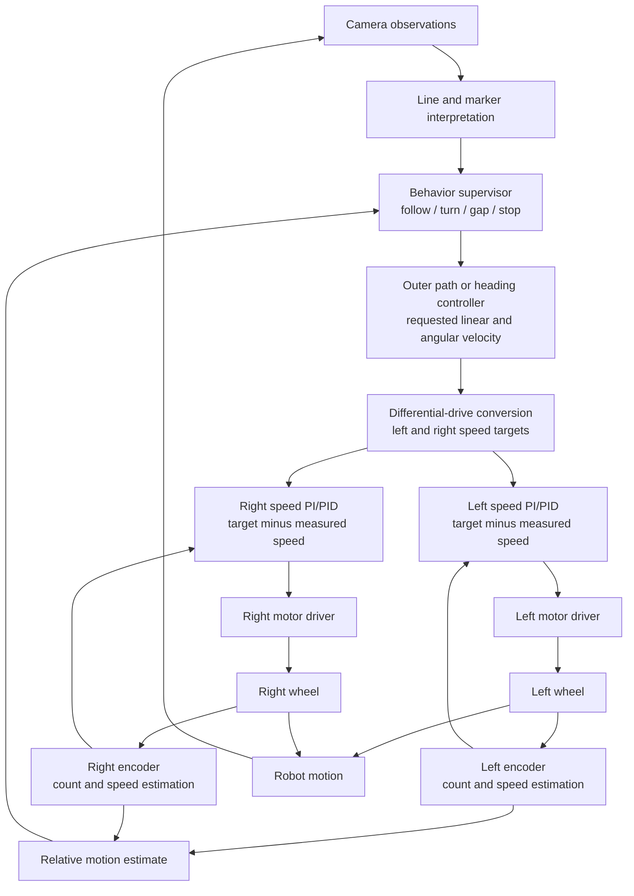
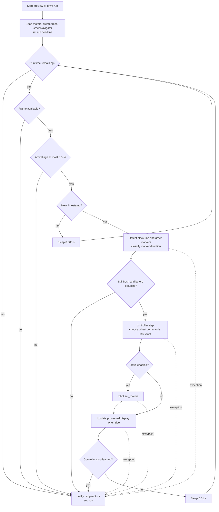
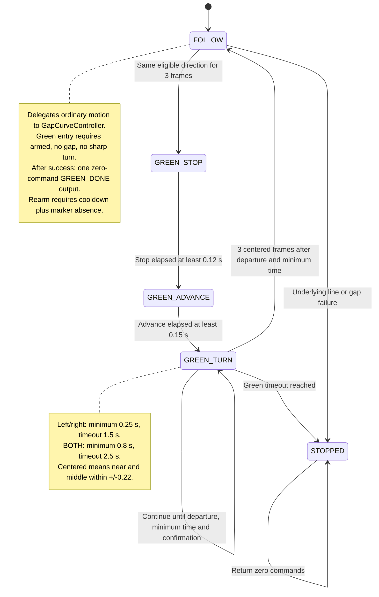

# JetBot Autonomous Line-Following Robot
## Midterm Project Design Report

**Design baseline:** `v4_repaired.ipynb`  
**Report date:** 9 October 2026  
**Status:** Code-grounded design report; physical performance measurements remain to be collected.  
**Evidence convention:** “Implemented” describes the supplied baseline and local JetBot library. “Reported” describes the team's observations. “Proposed” describes work not implemented in this baseline.

## Report overview

The report explains how a camera-based mobile robot senses a course, selects an action, and controls its wheels under embedded-system constraints. It separates the system that exists today from a proposed encoder-feedback upgrade.

| Section | Topic | Design question addressed |
|---|---|---|
| 1 | Executive summary and scope | What has been built, and what is not yet demonstrated? |
| 2 | Requirements and acceptance criteria | What must the robot do, and how will success be measured? |
| 3 | Embedded-system principles | How do sensing, computation, timing, actuation and physical constraints interact? |
| 4 | Complete current architecture | Which components exchange information and commands? |
| 5 | Vision and perception | How are line position and green instructions extracted? |
| 6 | Current steering and maneuver control | Why are proportional steering and discrete states combined? |
| 7 | PID controller, motor driver and encoder | What does each component do, and how could feedback improve motion? |
| 8 | Code flowchart and state diagrams | In what order does the program execute and change behavior? |
| 9 | Timing, concurrency and resource use | How does execution time affect the physical robot? |
| 10 | Fault handling and reliability | What makes the robot stop, and what is not protected? |
| 11 | Design decisions and alternatives | Why were these approaches chosen, and what tradeoffs remain? |
| 12 | Verification and validation | What evidence exists, and which experiments are still required? |
| 13 | Limitations and development plan | What should change next, and in what order? |
| 14 | Conclusions | What can defensibly be claimed at midterm? |
| Appendices | Parameters, code traceability and references | Where can a reviewer verify the design? |

**Figures included:** current physical/software architecture; proposed encoder feedback architecture; main runner flowchart; green navigation state machine; line/gap behavior state diagram.

## 1. Executive summary and project scope

The project develops an autonomous differential-drive JetBot that follows black floor tape, responds to green directional markers, negotiates curves and attempts short gaps in the tape. A camera supplies environmental measurements; Python and OpenCV convert those measurements into line offsets and marker instructions. A hierarchy of controllers converts the observations into left and right motor commands.

The implementation combines continuous-valued proportional steering with discrete behaviors for sharp turns, line searching, gap crossing and marker-directed maneuvers. This is a hybrid control design: proportional feedback is appropriate while a usable line is visible, whereas a state machine manages situations requiring a sequence of distinct actions.

The selected midterm baseline is `v4_repaired.ipynb`, which the team reports as its best-working version. That assessment is qualitative. A documented full-course completion rate, timing distribution and measured turn-angle accuracy have not yet been supplied. The report therefore does not claim that the robot reliably completes the course.

The baseline uses three image bands, a proportional steering gain, timed state guards and visual reacquisition. It does not implement a full PID controller, wheel encoders, an IMU, measured wheel speed, measured 90-degree rotation, mapping or ROS 2. A repository file called `jpeg_encoder.py` concerns image compression; it is not a wheel-motion sensor.

Later v6–v8 experiments explored different turn behavior and tracking. Their features are not attributed to this baseline. In particular, v4's ordinary sharp turns normally stop the inner wheel, while green turns reverse it; v4 also retains its short forward advance before a green turn.

## 2. Requirements and acceptance criteria

### 2.1 Functional requirements

| ID | Requirement | Implemented mechanism | Verification needed |
|---|---|---|---|
| F1 | Follow straight and moderately curved black tape | Three-band line extraction and proportional motor correction | Repeated straight and curved track trials |
| F2 | Recover through sharp bends | Threshold-triggered pivot, remembered direction and bounded search | Left/right corners and consecutive bends |
| F3 | Interpret green directions | HSV detection, position relative to the line and three-frame confirmation | No-marker, left, right, paired and misleading-marker trials |
| F4 | Execute marker maneuvers | Stop, advance, rotate and visually reacquire the line | Correct branch selection and exit alignment |
| F5 | Cross a short white gap when justified | Recent straight-line evidence and bounded forward motion | Increasing gap lengths under controlled conditions |
| F6 | Avoid using stale images | Camera-arrival timestamps and freshness checks | Camera interruption and slow-processing tests |
| F7 | Provide stationary diagnostics | Preview uses the same decision logic without applying drive commands | Verify no nonzero motor command in preview |
| F8 | End a failed or completed run with a stop command | Latched controller failures and runner cleanup | Stop-path and exception tests |

### 2.2 Nonfunctional requirements

The robot must make decisions soon enough for the observed scene to remain relevant. Parameters must be easy to inspect and calibrate. State information and overlays must let the team diagnose errors without guessing. The design should bound recovery attempts rather than permit indefinite blind movement. Hardware variation, battery state, traction and camera placement must be considered during validation.

No quantitative acceptance targets are invented here. Before final testing, the team should agree targets for completion rate, interventions per run, maximum allowable loss duration, corner exit alignment, maximum processing delay and repeatability. Those targets should remain fixed when comparing versions.

### 2.3 Scope boundaries

The course is assumed to provide visually distinguishable black tape and green markers within camera view. The software does not establish that a marker is positioned before a valid intersection. Paired markers are interpreted as a U-turn instruction in v4, which must be checked against the actual course rules. A physical 90-degree corner is not explicitly classified from calibrated geometry.

## 3. Embedded-system principles demonstrated

### 3.1 Sensing, computation and actuation

The Jetson is an embedded processor because it performs a dedicated physical task as part of the robot. The camera is the sensor; image processing and control are computation; the motor driver and motors are actuation; the robot and floor form the physical process being controlled. Wheel motion changes the next image, closing a visual feedback loop.

The laptop interface supports launching code and observing status. It is not the component computing each motor command when the notebook kernel runs on the Jetson. Wireless communication is therefore an operator interface, not a replacement for local sensing. The notebook does not implement an explicit stop-on-Wi-Fi-disconnection policy.

### 3.2 Software layers and hardware abstraction

The notebook specifies motor intent using normalized left/right values. The `Robot` class delegates those values to `Motor` objects. The local motor implementation maps the values into direction and speed commands for the driver. This abstraction lets the navigation code avoid low-level driver operations, although it does not make hardware calibration unnecessary.

A command such as `0.15` is not 0.15 m/s and is not a measured 15% of maximum wheel speed. The driver applies effort; actual movement depends on the mechanical and electrical system.

### 3.3 Real-time constraints

The program is time-sensitive but is not shown to provide hard real-time guarantees. Camera capture, Linux scheduling, Python execution, OpenCV and display updates affect response latency. A sleep of 0.01 seconds does not establish a 100 Hz control loop.

Three different quantities must be distinguished: camera capture rate, processed-frame control rate and display refresh rate. The default local camera implementation is configured for 30 frames/s, while the runner schedules the processed display at approximately 10 updates/s. Neither value is a measured control rate on the deployed robot.

### 3.4 Discrete state, hysteresis and bounded recovery

The controller retains state across frames: current turn, last useful direction, recent straight-line evidence and marker confirmation. This memory prevents each image from producing an unrelated decision. Different entry and exit thresholds provide hysteresis, reducing repeated switching near a single threshold. Timeouts bound how long the robot can continue a failed maneuver, provided execution remains responsive.

## 4. Complete current architecture

### 4.1 Hardware and interface inventory

| Component | Role | Evidence and qualification |
|---|---|---|
| Jetson-based JetBot | Runs the camera and control software | Project platform; exact deployed board revision and OS must be recorded |
| Camera | Supplies BGR images to the notebook | Notebook requests 224 × 224; default local backend uses OpenCV/GStreamer and `nvarguscamerasrc` |
| Two independently driven wheels | Translate and rotate the robot | Left/right motor commands in `Robot` |
| Motor-driver board | Applies motor direction and drive effort | Local code uses `Adafruit_MotorHAT`; board-specific Waveshare PWM writes are present |
| I²C connection | Transfers driver-control operations | `Robot` defaults to I²C bus 1; motor channels 1 and 2 |
| Power supply/battery | Powers processing and actuation | Required physically; exact ratings and wiring are not established by the notebook |
| Notebook browser interface | Displays preview and accepts operator execution | `ipywidgets` and IPython display |
| Wheel encoders / IMU | No role in the current feedback loop | Not used in v4; team has described the current setup as camera-only |

The diagram is a functional architecture, not a verified electrical wiring schematic. The final hardware appendix should add actual board part numbers, pinout, motor voltage/current requirements, regulator arrangement, common-ground routing and photographs. These cannot be inferred safely from a Python import.

### 4.2 Current architecture diagram

The bidirectional class arrows represent calls and returned commands, not independent parallel controllers competing for the motors. Only the runner applies the chosen pair of motor values.

### 4.3 Data interfaces

| Interface | Data | Meaning |
|---|---|---|
| Camera → callback | BGR image array | Current observed scene |
| Callback → runner | `(frame, timestamp)` | Latest image and monotonic callback-arrival time |
| Line detector → controller | `near`, `middle`, `far` offsets or `None` | Normalized horizontal measurements; `None` means unavailable, not centered |
| Green detector → classifier | Marker centroid, area and bounding box | Candidate colored regions |
| Classifier → supervisor | `NONE`, `UNKNOWN`, `CENTER`, `LEFT`, `RIGHT`, `BOTH` | Marker interpretation |
| Controller → runner | `(left, right, state)` | Requested actuation plus diagnostic state |
| Runner → motor API | Signed normalized commands | Actuation only when driving is enabled |

### 4.4 Library and framework choices

OpenCV handles thresholding, masks, morphology, contours and drawing. NumPy supports image arrays and numerical operations. Traitlets supplies camera change notifications and value links. Jupyter widgets provide the diagnostic interface. The JetBot library supplies camera and motor abstractions. ROS 2 is not part of this implementation, and no ROS node/topic architecture should be claimed for it.

## 5. Vision and perception design

### 5.1 Black-line extraction

`detect_curve()` converts the frame to grayscale, applies a 5 × 5 Gaussian blur, then uses an inverted threshold at 70. Dark image regions become foreground in a binary mask. Three horizontal strips are inspected independently:

| Band | Vertical fraction of image | Intended observation |
|---|---|---|
| Near | 0.72–0.88 | Line position close to the robot |
| Middle | 0.54–0.70 | Intermediate path direction |
| Far | 0.36–0.52 | Upcoming bend |

For each strip, the largest external contour is selected. It is accepted only if its area is greater than 0.5% and less than 80% of the strip and its centroid is valid. The horizontal centroid `cx` becomes:

`offset = (cx − image_width/2) / (image_width/2)`

Negative means left of image center, positive means right, and zero means centered. This representation makes the steering calculation independent of raw horizontal pixel units. It does not convert the measurement into physical distance from the tape.

Three bands provide a simple view of immediate and upcoming line geometry without requiring a full map. The tradeoff is that the largest contour in each band may belong to a different branch. A shadow or broad intersection can also be selected. The algorithm does not explicitly connect the contours into a persistent path.

### 5.2 Green-marker extraction

`detect_green()` converts the original frame to HSV and selects values between `[35,70,50]` and `[90,255,255]`. It limits detection to 45–92% of image height. A 3 × 3 opening and closing suppress small artifacts and repair small mask discontinuities. Contours are filtered to areas of 40–3000 pixels² and width/height ratios of 0.4–2.5.

Area and shape filters reduce false candidates, but they are not proof that a region is a physical course marker. Their pixel-based values depend on the configured resolution and marker scale. Calibration must use the actual tape and lighting.

The drawn green line-centroid dots cannot become detected markers because green detection uses the original frame; diagnostic drawing uses a separate copy.

### 5.3 Marker interpretation relative to the line

At least two visible line bands are needed to estimate the line direction. The classifier uses the nearest and farthest available local band points, checks the marker's side using signed geometry, and accepts only markers whose centers are at least 65% down the image. Eligible side distance is greater than 8 and no more than 65 pixels.

A qualifying left marker produces `LEFT`; a right marker produces `RIGHT`. Markers on both sides produce `BOTH` only if at least one pair differs vertically by no more than 15% of image height. Otherwise the result is `UNKNOWN`. `CENTER` is a fallback when markers exist but none qualifies; it does not necessarily mean literally centered tape.

This is a geometric heuristic. It does not verify intersection topology, marker ordering along the route or that the outgoing branch is the intended branch.

## 6. Current steering and maneuver control

### 6.1 Why the controller is hierarchical

`GreenNavigator` owns a `GapCurveController`, which extends `CurveController`. This separates three responsibilities: interpret course instructions, decide whether missing tape could be a gap, and steer along available tape. Active green maneuvers take control until completion or failure. Otherwise gap/curve logic supplies motor commands.

This separation improves readability and makes controller decisions testable without a camera or motors. It also means interactions matter: green instructions cannot start during an active gap or sharp line turn in the baseline.

### 6.2 Proportional steering and spatial anticipation

The visible-band weighted error is:

`e_weighted = Σ(w_i × offset_i) / Σ(w_i for visible bands)`

Nominal weights are near = 0.45, middle = 0.35 and far = 0.20. If near and a farther band are available, the controller adds:

`e = clamp(e_weighted + 0.40 × (farther − near), −1, +1)`

The far band is preferred; middle substitutes if far is unavailable. With all three present, the unclipped expression simplifies to:

`e = 0.05 × near + 0.35 × middle + 0.60 × far`

This is a significant design consequence: the complete error emphasizes the distant observation more strongly than the initial weights suggest. It can anticipate bends, but may react early or respond strongly to a competing far branch. The spatial difference is not a PID derivative term: it compares locations in one image, not change over time.

During `FOLLOW`:

`bend = min(abs(e)/0.55, 1)`  
`base = 0.15 + (0.13 − 0.15) × bend`  
`correction = 0.14 × e`  
`left = clamp(base + correction, 0, 0.25)`  
`right = clamp(base − correction, 0, 0.25)`

A positive line offset makes the left wheel faster and steers right under the robot's logical wheel convention. The code deliberately lowers forward command as the error grows. There is no integral accumulation and no time derivative of error.

### 6.3 Sharp turns and searching

A sharp turn starts when `abs(e) >= 0.55`. It ends when the near offset and combined error are both below 0.22 in magnitude. These separate thresholds provide hysteresis. The turn direction remains latched during the maneuver.

With v4's `ALLOW_REVERSE = False`, a right turn requests `(0.15, 0)` and a left turn `(0, 0.15)`. The robot therefore advances around the inner wheel rather than ideally rotating at its axle midpoint. An accepted near/error alignment exits the turn; otherwise the turn timeout is 1.0 second. In the visible-line code path, the alignment exit is checked before that timeout.

When all bands disappear and gap handling is not justified, the controller searches in the remembered direction. No remembered direction causes an immediate stop. Continuous loss reaches a stop at 0.35 seconds; the turn timeout is also checked. Loss timing resets when a line observation returns, but the maneuver timer is not restarted merely because one frame is visible.

### 6.4 Gap crossing

Gap entry requires recent evidence of straight following: near is visible, at least two bands are visible, all visible offsets are within ±0.25, their spread is at most 0.12, and at least three qualifying observations have accumulated. The latest qualifying observation must be no more than 0.6 seconds old. A brief single-band transition may preserve that earlier evidence.

When every band then disappears and no sharp turn is active, the controller drives forward at `GAP_SPEED = 0.15` with a small remembered correction. The correction is limited to ±0.015 and smoothed from recent wheel-command differences. It is not a heading measurement.

Near and middle must both return for two consecutive processed frames to end the gap. They need not be centered. The original 1.0-second gap deadline remains active through isolated detections. This is bounded open-loop crossing with visual monitoring for tape return, not closed-loop position control across the white region.

### 6.5 Green maneuvers

Three matching eligible observations request a maneuver. The first two still permit normal line control. Once confirmed, the robot stops for 0.12 seconds, advances at 0.15 for 0.15 seconds, then turns with equal opposite motor commands. Right uses `(0.15, −0.15)`; left uses `(−0.15, 0.15)`. `BOTH` also rotates left but applies the U-turn timing guards.

Success requires a prior observation that near/middle are not both centered, the minimum turn duration, and then three consecutive centered near/middle observations. The minimum duration is 0.25 seconds for left/right and 0.8 seconds for `BOTH`; timeouts are 1.5 and 2.5 seconds. These timers start after the advance. They are not measured turn angles.

After completion, the controller resets line/gap history and returns zero commands for one `GREEN_DONE` iteration. Triggering remains disarmed until both a 0.8-second cooldown has elapsed and five consecutive `NONE` classifications have occurred. Those absence frames may accumulate during the cooldown. This prevents repeated use of the same marker but can suppress a closely following new marker.

## 7. PID controller, motor driver and encoder

### 7.1 Clarifying the terms

“PID controller → controller → encoder” mixes different meanings of controller. A PID controller is a mathematical feedback algorithm. The Jetson or a microcontroller executes that algorithm. A motor driver is the power interface that acts on its output. An encoder measures resulting rotation and supplies feedback.

The intended loop is:

**Target → error calculation → PID algorithm → motor driver → motor/wheel → encoder measurement → error calculation.**

An encoder is therefore a feedback sensor, not the final recipient of a drive command. A camera can also provide feedback to a controller; PID does not inherently require an encoder.

### 7.2 P, I and D concepts

For a generic measured variable `y` and desired reference `r`, define `e = r − y`. A discrete PID expression is:

`u[k] = Kp·e[k] + Ki·Σ(e[j]·Δt[j]) + Kd·(e[k] − e[k−1])/Δt[k]`

Proportional action responds to present error. Integral action responds to accumulated error and can address persistent bias. Derivative action responds to the rate of change and can shape damping, but is sensitive to measurement noise. These are controller design choices rather than a guarantee that all three terms improve every system. [MIT, PD and PID Control](https://introcontrol.mit.edu/_static/fall24/lectures/PD_and_PID_Controllers-handout.pdf)

The existing notebook uses its own steering sign convention: positive image error demands a right turn. A future generic PID implementation must preserve the intended feedback sign rather than copy gains without checking motor and measurement directions.

### 7.3 Applying the concepts to this project

There are two different candidate control loops:

| Loop | Desired quantity | Measurement | Output | Current status |
|---|---|---|---|---|
| Visual path loop | Centered, correctly oriented line | Camera-derived line error | Steering correction or chassis motion request | Proportional steering implemented |
| Wheel-speed loop | Left/right wheel speed | Encoder-derived wheel speed | Motor drive effort | Proposed; absent in v4 |

For the visual loop, adding a filtered derivative term could be evaluated if recordings show oscillation with otherwise reliable detections. Integral action should be considered only after identifying a persistent bias. Integrating during a gap, a wrong-branch detection or a saturated pivot could store an inappropriate correction for the next state. A future implementation should explicitly freeze/reset relevant state across those transitions.

For wheel-speed regulation, start with a measured response and tune one wheel at a time. A PI controller may be sufficient; derivative action should be justified by evidence. Camera gains and wheel-speed gains act on different units and cannot be reused interchangeably.

A PID implementation needs correct sample timing, output limits and managed internal state. Fixed-period libraries assume calls match their configured interval; state reset and integral limiting are practical provisions to consider. These are proposed requirements, not facilities already present in v4. [WPILib, PID Control](https://docs.wpilib.org/en/stable/docs/software/advanced-controls/controllers/pidcontroller.html)

### 7.4 Encoder measurements

A quadrature encoder supplies two phase-shifted channels. Their transitions support count and direction estimation; counts can be converted to shaft displacement and rate. Hardware placement and decoding convention determine the scale. [WPILib, Encoders](https://docs.wpilib.org/en/stable/docs/software/hardware-apis/sensors/encoders-software.html)

For a proposed implementation, define `N` explicitly as decoded counts per wheel revolution, including gearing and the selected edge-count convention. If wheel radius is `r_w`:

`distance per count = 2πr_w / N`  
`Δs_L = 2πr_w × Δcount_L / N`  
`Δs_R = 2πr_w × Δcount_R / N`  
`v_L = Δs_L / Δt`, `v_R = Δs_R / Δt`

The distance/count equations are a proposed calibration model, not measured robot constants. Left and right wheels may require separate calibrated values. No wheel radius, track width, encoder resolution or motor part number is invented in this report.

### 7.5 Proposed cascaded architecture

This diagram is future work. One possible partition is to keep vision and maneuver selection on the Jetson and run encoder counting plus wheel loops on a dedicated microcontroller. The interface would carry timestamped speed targets, feedback and a command-expiry policy. The choice should follow measured timing and interface needs; a microcontroller is not a mandatory prerequisite to every encoder implementation.

### 7.6 Differential-drive motion and 90-degree turns

Using forward-positive wheel velocities and counterclockwise-positive chassis rotation, with wheel separation `b`:

`v = (v_R + v_L)/2`  
`ω = (v_R − v_L)/b`  
`v_L* = v* − bω*/2`, `v_R* = v* + bω*/2`

This is the standard relationship between chassis motion and left/right wheel speeds. [WPILib, Differential Drive Kinematics](https://docs.wpilib.org/en/stable/docs/software/kinematics-and-odometry/differential-drive-kinematics.html)

From the same ideal rolling model, the team's proposed encoder-based relative turn estimate is `Δθ = (Δs_R − Δs_L)/b`. A left 90-degree in-place turn requires ideal signed wheel travel `Δs_R = +πb/4` and `Δs_L = −πb/4`; a right turn reverses those signs. Equal opposite physical wheel speeds give zero ideal center translation, whereas a stationary inner wheel gives a center arc radius of approximately `b/2`.

Equal opposite motor commands do not establish equal opposite physical wheel speeds. Encoders would let the controller regulate that difference. However, wheel rotation still does not prove floor-relative motion when wheels slip. Encoders also cannot identify the correct tape branch. A proposed turn should combine a bounded relative-motion target with visual confirmation of the outgoing line, and stop on disagreement rather than blindly assume success.

Before integrating encoders, verify mechanical compatibility, voltage levels, signal interfaces, count rate and bidirectional operation for the actual hardware. The present repository does not establish these details.

## 8. Code flowchart and state diagrams

### 8.1 Main runner flowchart

The `finally` block also executes for other ordinary exceptions inside the protected loop. A normal run-duration expiry or camera fault ends the runner directly; it need not set a controller's internal stopped flag. If the process or driver freezes, this cleanup cannot be assumed to execute.

### 8.2 Green supervisor state diagram

`GREEN_DONE` is an output label for a transition iteration, not a persistent `self.state`. The cooldown/armed flag is additional state rather than a separate stopped mode. During the cooldown the robot can continue ordinary line following.

### 8.3 Ordinary line and gap behavior diagram

```mermaid
stateDiagram-v2
    [*] --> FOLLOW
    FOLLOW --> TURN: Error magnitude at least 0.55
    TURN --> FOLLOW: Near and combined error within 0.22
    FOLLOW --> GAP: All bands lost with recent straight evidence
    GAP --> GAP: Await 2 near-and-middle detections
    GAP --> EVALUATE: Tape confirmed before gap deadline
    EVALUATE --> FOLLOW: Ordinary error below turn threshold
    EVALUATE --> TURN: Ordinary error reaches turn threshold
    FOLLOW --> SEARCH: All bands lost; no gap evidence; direction known
    TURN --> SEARCH: All bands lost; retained turn direction
    SEARCH --> TURN: Line returns but alignment not yet sufficient
    SEARCH --> FOLLOW: Line returns aligned
    GAP --> STOPPED: Gap timeout
    TURN --> STOPPED: Turn timeout without accepted alignment
    SEARCH --> STOPPED: Lost-line or turn timeout
    FOLLOW --> STOPPED: Line lost with no known direction
    STOPPED --> STOPPED: Zero commands until a fresh run
```

This is a behavioral abstraction of flags and returned labels; `CurveController` does not store a string state enum. `EVALUATE` represents same-call reevaluation after gap confirmation, not an additional stored state. Active green maneuvers supersede these behaviors through the outer supervisor.

## 9. Timing, concurrency and resource use

The camera backend captures frames in a background thread. The observer stores the image and callback-arrival timestamp together as a tuple. The runner reads that tuple into a local variable. This reduces the chance of combining a frame with a separately updated timestamp. It is not a formal cross-platform concurrency proof.

The latest-frame approach avoids a growing application queue: processing uses the newest available sample and may skip intermediate frames. That favors current decisions over processing every image. It does not remove buffering or latency inside the camera pipeline. The freshness timestamp records callback arrival, not sensor exposure.

Freshness is checked before repeated-frame skipping, so a frozen camera is still detected while the runner waits. A second check after vision processing prevents use of a frame that aged excessively during computation. The processed display is throttled to approximately one update per 0.1 seconds, but the separately linked live camera widget can still impose work on camera updates.

One 224 × 224 three-channel 8-bit frame contains 150,528 bytes, approximately 147 KiB, before array-object overhead. Masks, HSV/grayscale conversions, overlays and contour data add memory and allocation work. The small processing resolution and simple image operations are reasonable implementation choices, but memory, CPU load and latency have not been benchmarked here.

Confirmation counts depend on processed-frame rate. Three frames take about 0.1 seconds at 30 processed frames/s but 0.3 seconds at 10; neither rate is asserted for the robot. During frame waiting and processing, previously applied motor commands remain active. Actual stop latency includes scheduling, processing, driver communication and mechanical response.

## 10. Fault handling and reliability

| Failure or uncertainty | Baseline response | Remaining limitation |
|---|---|---|
| No camera sample | End run and stop in cleanup | No independent hardware stop path |
| Stale camera sample | End run when age exceeds 0.5 s | Arrival time does not measure full exposure-to-action latency |
| Excessive vision processing time | Recheck freshness and deadline before commanding | Current command may persist while processing runs |
| Line disappears | Gap crossing if justified; otherwise bounded search or immediate stop | Does not know which failure physically caused the loss |
| Sharp turn fails | Latched stop on timeout when exit not accepted | No measured rotation |
| Green turn fails | Latched stop; timeout checked before success | No branch-identity proof |
| Gap is too long | Latched stop at original gap deadline | No measured distance/heading while crossing |
| Repeated view of one marker | Cooldown and required marker absence | Closely spaced new markers can be ignored |
| Wrong contour selected | May still produce valid-looking steering data | No baseline confidence-based path validation |
| Python exception in protected runner | `finally` requests motor stop | Does not protect against a hung process or failed stop command |
| Low supply voltage or motor mismatch | No automatic compensation established here | Can alter actual motion and available torque |

The code's latched stop prevents automatic restart merely because a later frame looks good. A new run creates fresh controller state. Preview begins and ends with stop commands and omits drive updates; it is useful for perception and logic checks but cannot reproduce actual motion dynamics unless the robot is repositioned manually.

Proposed reliability improvements include a separate command watchdog near the motor-control layer, timestamped diagnostic logging, explicit observation confidence, and stop behavior for invalid future encoder feedback. These must be described as future work rather than existing protections.

## 11. Design decisions and alternatives

The following rationale is reconstructed from the implementation and the team's stated goals. It is not a claim that a formal comparative experiment was performed for every decision.

| Decision | Engineering rationale | Cost or limitation | Alternative to evaluate |
|---|---|---|---|
| Camera rather than only point reflectance sensors | One sensor provides line shape and marker color | Lighting and field-of-view sensitivity | Additional close-range line sensor |
| Three strips rather than full map | Small, interpretable measurement set | Independent contours may conflict | Connected-path or temporal tracking |
| Grayscale threshold and HSV mask | Directly inspectable and easy to calibrate | Fixed thresholds depend on conditions | Adaptive segmentation after failure analysis |
| Largest contour per band | Simple noise rejection | Large distractor can win | Multiple candidates with continuity tests |
| Proportional steering | Low implementation complexity | No accumulated-bias or temporal damping term | Measured PD/PI/PID comparison |
| Spatial lookahead | React before the near line moves strongly | May cause early turns | Explicit heading estimate and controlled lookahead |
| Different turn entry/exit thresholds | Reduce state switching | Thresholds require calibration | Confidence-aware or profiled turn control |
| Stationary inner wheel for ordinary turns | Avoid default wheel reversal | Forward arc may move off the corner | In-place reversal or gradual capture |
| Reverse inner wheel for green turns | Compact turning after junction approach | Slip and unequal speeds affect pivot center | Encoder-regulated wheel speeds |
| Stop then timed advance for green turns | Separate approach from rotation | Time is an uncertain proxy for distance | Calibrated geometry or encoder distance |
| Multiple-frame confirmation | Reject isolated detection changes | Adds delay that depends on processing rate | Time-based or confidence-based confirmation |
| Bounded gap crossing | Traverse short intentional discontinuities | Open-loop travel can drift | Encoder/heading-assisted crossing |
| Latest frame instead of queue | Favor current observations | Some frames are skipped | Timestamped bounded queue if required by tracking |
| Jupyter preview | Fast inspection and calibration | Execution order and UI load need discipline | Packaged application after stabilization |

The team's return to v4 as its best-working baseline is an important design decision: additional complexity is not evidence of improved performance. Later tracking, band or turn changes should be treated as hypotheses and compared against a fixed baseline using identical course sections and recorded conditions.

ROS 2 could later organize communication and diagnostics, but it would not make a wrong contour correct or supply missing physical measurements. An encoder upgrade and a middleware migration are independent decisions.

## 12. Verification and validation

### 12.1 Evidence available at midterm

On 9 October 2026, the existing `test_v4_repaired.py` suite was executed locally: **10 tests passed**. These tests compile notebook code and exercise controller behavior using supplied positions/timestamps, plus marker-classification geometry. They cover confirmation resets, stop/advance/turn sequencing, motor turn signs, premature-reacquisition prevention, cooldown, green timeout latching, U-turn guards and gap success/timeout.

They do not execute the real camera, motor electronics or floor motion. They also do not establish segmentation accuracy from actual images, end-to-end runner timing, full exception coverage, power behavior or course completion. Passing unit tests is evidence of selected software behaviors, not proof that the physical robot is reliable.

The team's reported evidence is that v4 is its most successful version, while sharp and closely spaced turns remain problematic. No numerical performance values are inferred from that description.

### 12.2 Proposed test progression

| Stage | Experiment | Record | Purpose |
|---|---|---|---|
| A | Stationary tape/marker observations | Raw image, masks, offsets, classifications | Verify perception before motor tuning |
| B | Wheel sign and low-command calibration | Command, movement direction, stall threshold, battery condition | Establish usable actuation range |
| C | Straight and gentle curves | Error trace, commands, interventions | Tune proportional following |
| D | Isolated left/right sharp corners | State trace and overhead video | Separate early entry, overshoot and wrong-line selection |
| E | Consecutive same/opposite bends | Band association and loss intervals | Expose direction latch and camera-coverage issues |
| F | Left/right/BOTH markers | Confirmation time, advance distance, selected branch | Validate course semantics and green sequencing |
| G | Closely spaced markers | Cooldown and clear-frame history | Test suppression of a valid next instruction |
| H | Increasing white gaps | Approach evidence, crossing duration, reacquisition | Determine justified operating envelope |
| I | Stale frames and injected exceptions | Last command and stop request timing | Verify software fault response |
| J | Repeated full course | Completion, interventions, failure locations | Validate overall usefulness |

For each comparison, record the notebook version, calibration values, track geometry, lighting, camera pose, battery condition and number of trials. Change one design factor at a time when isolating a cause. Repeated controlled trials should precede broad full-course tuning.

### 12.3 Metrics and logging

A proposed diagnostic record should include a monotonic timestamp, image reference, frame age, processing duration, three band offsets, marker result, controller state, left/right commands and stop reason. Logging is not automatically present in the baseline. Raw frames should be sampled at a rate that does not itself cause excessive control delay.

Useful metrics include completion fraction, interventions per attempt, correct marker branch fraction, time without a valid line, time in recovery and percentile processing latency. Mean absolute line offset is meaningful only when the detection corresponds to the correct tape; a confidently tracked wrong branch can have a small error. Physical turn angle and axle position require independent observation or added motion sensing.

| Result | Midterm status |
|---|---|
| Baseline software regression tests | 10/10 passed locally |
| Full-course completion rate | Not measured in the supplied evidence |
| Mean/peak line-position error on real course | Not measured |
| Actual 90-degree turn accuracy | Not measured |
| Motor speed versus command | Not measured |
| Control-loop latency distribution | Not measured |

## 13. Limitations and next development steps

The major current limitations are independent band selection, no reliable angle or wheel-speed measurement, finite camera view, motor variation, timed rather than measured approach distance, and marker suppression that may block a following instruction. Adding PID alone would not fix missing or incorrectly associated visual observations.

The recommended sequence is:

1. Preserve the baseline and calibration, and capture diagnostic evidence at failed corners.
2. Determine whether each failure originates in perception, trigger position, loss of view, actuation or state transitions.
3. Improve the specific weak point and compare with the baseline. Evaluate extra bands or path tracking only with evidence that they observe useful tape rather than background or a competing branch.
4. Characterize motors and measure wheel dimensions and separation.
5. If accurate wheel motion is required, select compatible encoders and implement reliable timestamped measurements before adding wheel-speed feedback.
6. Tune inner wheel loops, then integrate the outer visual controller. Preserve fault stops and explicit state transitions.
7. Consider a gyro for heading observations and middleware for larger-system integration only when their additional requirements are justified.

The encoder proposal needs both hardware and software work. The expected benefit is more repeatable wheel motion, not automatic course understanding. Its added integration cost must be weighed against the project schedule and the evidence from camera-only testing.

## 14. Conclusion

The current project demonstrates an embedded sensing-to-actuation loop, layered hardware abstraction, proportional visual control, state-based navigation, hysteresis, temporal confirmation and bounded fault recovery. The architecture is understandable and testable, which makes it a useful experimental baseline.

The defensible midterm claim is that the team has implemented and unit-tested a camera-based hybrid line-following controller with green-marker and gap behaviors. Reliable course completion, exact corner-centered rotation and measured 90-degree turns have not been demonstrated by the supplied evidence.

The proposed encoder architecture adds feedback about what the wheels actually did. That complements camera information about where the path is. Keeping those responsibilities separate is the central control-design decision for the next stage.

## Appendix A. Key baseline parameters

Values below are the saved notebook defaults, not certified floor calibration.

| Group | Parameters | Meaning |
|---|---|---|
| Following | `BASE_SPEED=0.15`, `CURVE_SPEED=0.13`, `KP=0.14`, `MAX_SPEED=0.25` | Drive effort, steering correction and command limit |
| Ordinary turns | `TURN_SPEED=0.15`, `ALLOW_REVERSE=False` | Stationary inner wheel by default |
| Turn thresholds | `TURN_ENTER=0.55`, `TURN_EXIT=0.22` | Entry/exit error magnitudes |
| Deadlines | `TURN_TIMEOUT=1.0`, `LOST_TIMEOUT=0.35`, `FRAME_TIMEOUT=0.5` | Seconds; different failure conditions |
| Line extraction | `BLACK_THRESHOLD=70`; three bands | Dark-region classification and spatial sampling |
| Marker proximity | `GREEN_TRIGGER_Y=0.65`, side margin 8 px, max side distance 65 px | Eligibility geometry |
| Gap evidence | 3 observations; age ≤0.6 s; alignment ≤0.25; spread ≤0.12 | Justifies an attempted crossing |
| Gap behavior | `GAP_SPEED=0.15`, timeout 1.0 s, steer limit 0.015, confirmation 2 frames | Bounded crossing and return detection |
| Green sequence | confirmation 3 frames; stop 0.12 s; advance 0.15 s at 0.15 | Maneuver initiation and positioning |
| Green turn | speed 0.15; minimum 0.25 s; timeout 1.5 s | Visual reacquisition with temporal guards |
| U-turn | minimum 0.8 s; timeout 2.5 s | Original BOTH-marker interpretation |
| Green rearming | reacquisition 3 frames; clear 5 frames; cooldown 0.8 s | Completion and duplicate-trigger suppression |

## Appendix B. Implementation traceability

Notebook cell indices below are zero-based JSON indices, not Jupyter execution numbers.

| Location | Responsibility |
|---|---|
| `v4_repaired.ipynb`, cell 1 | Robot/camera initialization and live display |
| Cell 2 | Latest-frame callback and arrival timestamp |
| Cell 4 | Black/green detection and direction classification |
| Cell 6 | `CurveController` and motor control parameters |
| Cell 8 | `GapCurveController` |
| Cell 10 | `GreenNavigator` |
| Cell 12 | `run_v4`, preview and drive wrappers |
| Cells 14, 16, 18 | Preview call, commented driving call and cleanup |
| `jetbot/camera/opencv_gst_camera.py` | Default local capture backend |
| `jetbot/robot.py`, `jetbot/motor.py` | Motor API, I²C configuration and driver mapping |
| `tests/test_v4_repaired.py` | Baseline hardware-free regression tests |

The camera backend can be selected by the `JETBOT_DEFAULT_CAMERA` environment variable. The report describes the default local backend, not a verified inventory of the running robot's environment.

## Appendix C. Sources and reporting integrity

Primary project evidence is the saved notebook, the accompanying local JetBot source and the baseline test suite. General control references support the proposed engineering discussion; their libraries are not claimed to be installed or used in this project.

- [MIT 6.310: PD and PID Control](https://introcontrol.mit.edu/_static/fall24/lectures/PD_and_PID_Controllers-handout.pdf).
- [WPILib: PID Control](https://docs.wpilib.org/en/stable/docs/software/advanced-controls/controllers/pidcontroller.html).
- [WPILib: Encoders](https://docs.wpilib.org/en/stable/docs/software/hardware-apis/sensors/encoders-software.html).
- [WPILib: Differential Drive Kinematics](https://docs.wpilib.org/en/stable/docs/software/kinematics-and-odometry/differential-drive-kinematics.html).

Before submission, add author/team details, actual hardware specifications, calibrated settings, course photographs and measured trial results. The report intentionally marks missing measurements rather than presenting estimates as experimental evidence.
